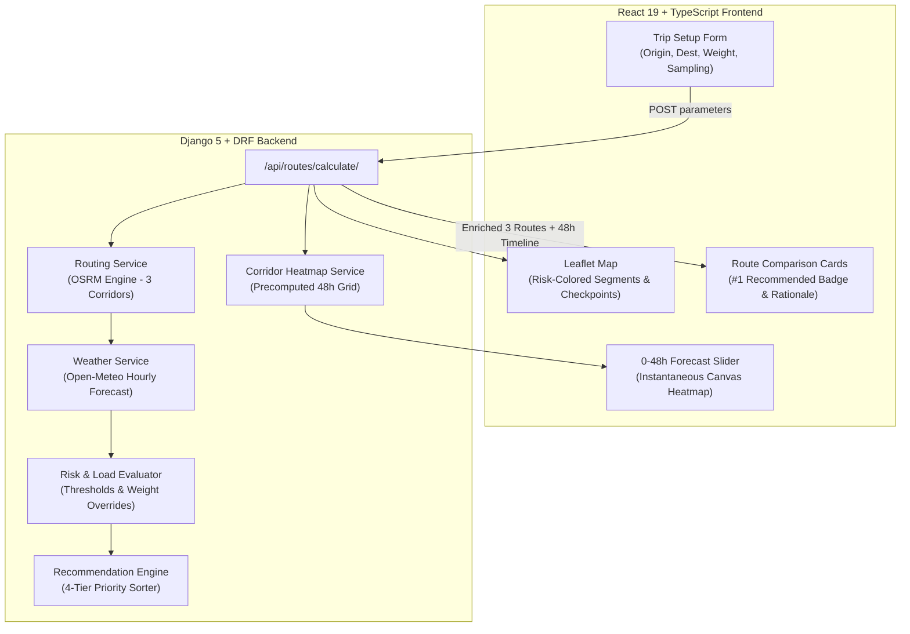

# Weather-Aware Truck Routing

[](#-running-automated-tests)
[](https://www.djangoproject.com/)
[](https://react.dev/)
[](https://tailwindcss.com/)
[](LICENSE)

A full-stack web application designed for commercial truck drivers and dispatchers to calculate, evaluate, and select the safest route based on real-time and forecasted weather hazards, gross truck load weights, and travel duration.

---

## 🌟 Key Features

- **3 Alternative Route Corridors**: Automatically generates 3 distinct, realistic driving options using the OSRM routing engine (Primary Interstate, Northern Bypass, and Southern Bypass corridors).
- **Dynamic Checkpoint Sampling**: Samples routes every **10, 25, or 50 miles** with exact cumulative distances and truck arrival ETAs.
- **Hourly Weather Matching**: Batch-queries Open-Meteo's hourly weather forecasts to evaluate conditions at the truck's exact estimated arrival time at each checkpoint.
- **Comprehensive Risk & Load Weight Rules**:
  - Thresholds for Wind (mph), Rain rate (in/hr), and Snow rate (in/hr).
  - Truck gross load weight overrides (e.g. loads >30,000 lb and >40,000 lb escalate wind risks).
- **Strict Recommendation Hierarchy**:
  1. Fewest **Severe** miles (and zero No Travel miles)
  2. Fewest **High** miles
  3. Lowest **average risk score**
  4. Shortest **travel times**
- **Interactive Dark Map (Leaflet)**:
  - Route segments color-coded by checkpoint risk (Green = Low, Yellow = Moderate, Orange = High, Red = Severe, Maroon = No Travel).
  - Checkpoint markers with detailed popups (mile marker, ETA, weather variables, risk drivers, load impacts).
- **Corridor Weather Heatmap with 0–48h Forecast Slider**:
  - Smooth, instantaneous timeline scrubbing from 0 to 48 hours.
  - Multi-metric view modes: Composite Risk, Wind Gusts/Speed, Precipitation/Snow.
  - Auto-play animation loop across 48 hours.
- **100% Automated Test Suite**: Comprehensive unit tests and API integration tests with pytest.

---

## 📐 System Architecture



---

## 🚦 Weather Risk & Load Weight Matrix

### Base Weather Thresholds

| Condition | Low (1) | Moderate (2) | High (3) | Severe (4) | No Travel (5) |
|---|---|---|---|---|---|
| **Wind** | $< 25$ mph | $25\text{--}34$ mph | $35\text{--}44$ mph | $45\text{--}54$ mph | $\ge 55$ mph |
| **Rain** | $< 0.10$ in/hr | $0.10\text{--}0.25$ in/hr | $0.25\text{--}0.50$ in/hr | $0.50\text{--}1.00$ in/hr | $> 1.00$ in/hr |
| **Snow** | $< 0.5$ in/hr | $0.5\text{--}1.0$ in/hr | $1.0\text{--}2.0$ in/hr | $2.0\text{--}3.0$ in/hr | $> 3.0$ in/hr |

### Gross Load Weight Overrides

- $\ge 55$ mph wind $\rightarrow$ **No Travel** for any load.
- $45\text{--}54$ mph wind $+ > 30,000$ lb $\rightarrow$ **No Travel** (normally Severe).
- $35\text{--}44$ mph wind $+ > 40,000$ lb $\rightarrow$ **Severe** (normally High).

---

## 🛠️ Tech Stack

- **Backend**: Python 3.12, Django 5.1, Django REST Framework, WhiteNoise, Gunicorn, Requests, Shapely, Pytest.
- **Frontend**: React 19, TypeScript, Vite, Tailwind CSS v4, Leaflet, Lucide Icons.
- **External APIs**:
  - Routing: OSRM Driving Engine
  - Weather & Geocoding: Open-Meteo Hourly Weather API (zero API keys required, free tier compliant)
- **DevOps**: Docker, Docker Compose, Render / Railway deployment ready.

---

## 🚀 Quick Start (Local Development)

### Prerequisites
- Python 3.12+
- Node.js 20+ & npm

### 1. Clone the repository
```bash
git clone https://github.com/saravana-bhava/weather-aware-truck-routing.git
cd weather-aware-truck-routing
```

### 2. Backend Setup
```bash
cd backend
python3 -m venv venv
source venv/bin/activate
pip install -r requirements.txt
python manage.py migrate
python manage.py runserver 8000
```
Backend runs on `http://127.0.0.1:8000`.

### 3. Frontend Setup
In a new terminal window:
```bash
cd frontend
npm install
npm run dev
```
Frontend runs on `http://localhost:3000` with automated proxying to the Django backend.

---

## 🐳 Docker Setup (Single Command)

To run the entire unified stack in Docker:
```bash
docker compose up --build
```
Access the application at `http://localhost:8000`.

---

## 🧪 Running Automated Tests

Run the full pytest suite:
```bash
cd backend
pytest -v
```

All 16 tests cover:
- Exact wind, rain, and snow boundary threshold classifications.
- Heavy load weight escalation rules (>30,000 lb and >40,000 lb).
- Multi-tier recommendation sorting and tiebreakers.
- Geocoding and route calculation API endpoints.

---

## 📡 API Reference

### 1. Calculate Routes & Weather Hazards
`POST /api/routes/calculate/`

**Request Body:**
```json
{
  "origin": { "lat": 41.8781, "lng": -87.6298, "name": "Chicago, IL" },
  "destination": { "lat": 40.7128, "lng": -74.0060, "name": "New York, NY" },
  "departure_time": "2026-10-18T10:00:00Z",
  "load_weight_lb": 45000,
  "sampling_interval_miles": 25,
  "include_heatmap": true
}
```

**Response (Summary):**
```json
{
  "routes": [
    {
      "route_id": "route_1",
      "name": "Primary Interstate Corridor",
      "rank": 1,
      "is_recommended": true,
      "recommendation_rationale": "Zero Severe or No-Travel weather hazards along the entire trip corridor...",
      "distance_miles": 790.4,
      "duration_hours": 14.9,
      "risk_summary": {
        "no_travel_miles": 0.0,
        "severe_miles": 0.0,
        "high_miles": 0.0,
        "moderate_miles": 48.0,
        "low_miles": 742.4,
        "average_risk_score": 1.15
      },
      "checkpoints": [...]
    }
  ],
  "corridor_bbox": [39.9856, -87.6298, 42.9206, -74.0056],
  "corridor_heatmap": {
    "timeline": [...]
  }
}
```

### 2. Geocoding Autocomplete
`GET /api/geocoding/search/?q=Chicago`

### 3. Health Check
`GET /api/health/`

---

## 🎬 Live Application & Walkthrough Demo
- **Hosted Application**: [https://weather-aware-truck-routing-ggl7.onrender.com/](https://weather-aware-truck-routing-ggl7.onrender.com/)
- **Walkthrough Video**: [walkthrough_demo.mp4](walkthrough_demo.mp4) (Also streaming at [https://weather-aware-truck-routing-ggl7.onrender.com/walkthrough_demo.mp4](https://weather-aware-truck-routing-ggl7.onrender.com/walkthrough_demo.mp4))

---

## 📄 License
MIT License.
